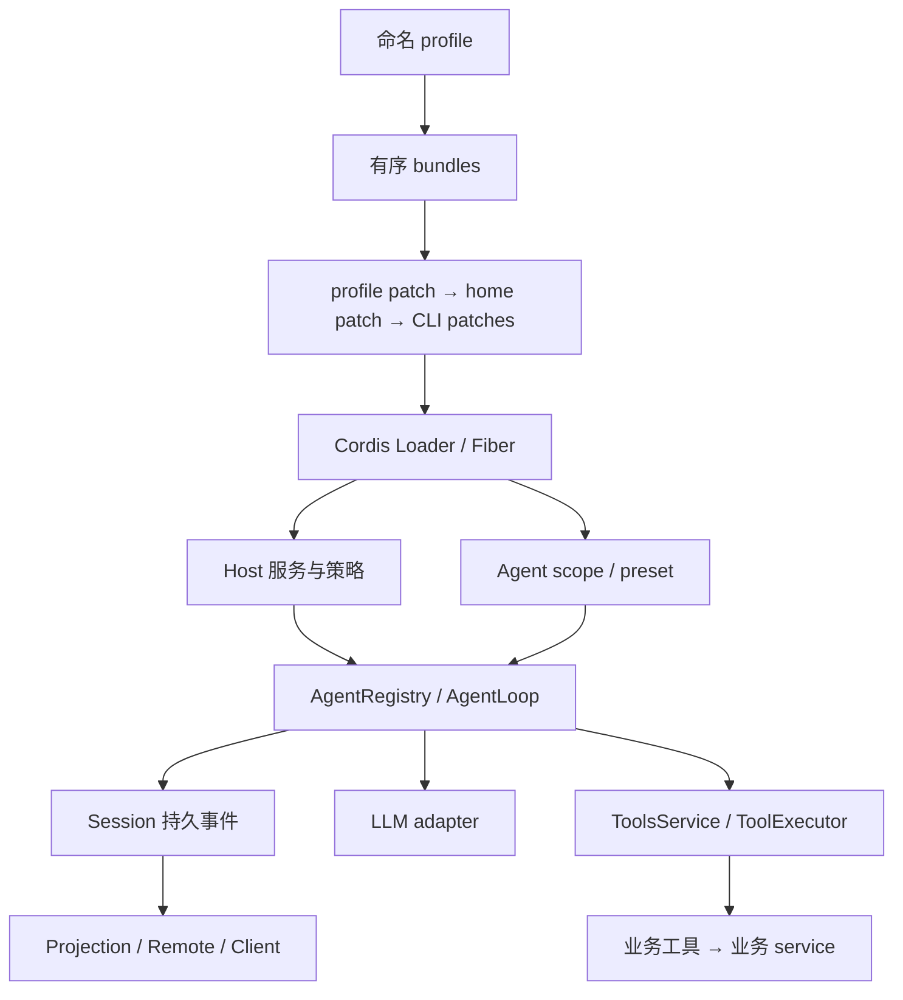

# 第一篇：以插件为单位设计 DSH 扩展

本篇面向需要决定“业务能力放在哪一层”的 AI 架构师与插件开发者。源码固定为 `22ddee3792402c3e70ec5f86a63c3e3e895a2f60`，声明版本 `0.2.1-rc.3`；它是 2026-10-25 查询所得官方 `master` HEAD，不等同于稳定版。本次对全部 386 个 workspace 包完成提交对象盘点，对插件开发相关路径进行重点复核；没有逐行审计全仓。

DSH 的组合单位是 Cordis 插件，运行单位是 Agent，持久事实归 Session。开发一个工单查询能力时，通常新增业务 service、工具 consumer 和可选 UI 插件；模型选择、工具可用性和资源授权分别使用已有接缝。先把这几项责任分开，才能判断哪些代码可以随插件撤销，哪些业务记录必须继续存在。[E01 · profile、bundle、支持的启动入口与组合顺序](https://github.com/deepseek-ai/deepseek-harness/blob/22ddee3792402c3e70ec5f86a63c3e3e895a2f60/docs/architecture.md#L9-L68)

## 1. 从部署装配到业务执行

图中上半部决定“哪些插件存在、配置从哪里来”，下半部决定“一个 Step 具体使用哪些能力”。两者有不同寿命：修改 profile 影响使用它的会话；Agent scope 限定注册的逻辑可见性；已经写入 Session 的模型选择不会随着插件卸载撤回。Scope 也不构成 OS 或企业租户隔离。[E01 · profile、bundle、支持的启动入口与组合顺序](https://github.com/deepseek-ai/deepseek-harness/blob/22ddee3792402c3e70ec5f86a63c3e3e895a2f60/docs/architecture.md#L9-L68) [E08 · modelSelection fold、AgentModel 与切换提示](https://github.com/deepseek-ai/deepseek-harness/blob/22ddee3792402c3e70ec5f86a63c3e3e895a2f60/packages/core/agent/src/model-selection.ts#L17-L174) [E04 · 工具查询、条件准入与 registration 身份复核](https://github.com/deepseek-ai/deepseek-harness/blob/22ddee3792402c3e70ec5f86a63c3e3e895a2f60/packages/core/tools/src/index.ts#L230-L300)

命名 profile 是支持的 Node 应用入口。当前模板包括 `web`、`headless`、`sdk`、`sdk-minimal`、`acp`。其中 `sdk-minimal` 自己拥有完整树，不叠加 `base`。SDK 自定义组合通过 profile 与有序 patches 表达。直接 `new Context()` 是本报告测试使用的组装方式，不能据此推荐一个绕开 `dsh` 的产品启动器。[E01 · profile、bundle、支持的启动入口与组合顺序](https://github.com/deepseek-ai/deepseek-harness/blob/22ddee3792402c3e70ec5f86a63c3e3e895a2f60/docs/architecture.md#L9-L68)

## 2. 按定义、提供者、消费者划分能力

|角色|承担的责任|工单能力中的示例|退出责任|
|---|---|---|---|
|Service Definition|明确参数、结果、失败与所有权|`TicketService.read` 返回脱敏后的工单视图|定义调用和取消义务|
|Service Provider|实现访问、资源管理和一致性|本地数据库或企业 HTTP connector|停止接纳、取消或排空、关闭连接|
|Consumer|把业务能力映射为工具、Remote 或界面|`ticket_read`、工单详情页|撤销注册、订阅和未完成请求|

上表工单接口是**设计建议**。DSH 官方要求一个完整 capability seam 同时考虑这三种角色；只有独立演化的角色才值得拆包。一个纯算术工具可保持单包；有审计、多个入口或多种执行环境的 connector 更适合先抽 service。不要为了形式把每个函数拆成包。[E01 · profile、bundle、支持的启动入口与组合顺序](https://github.com/deepseek-ai/deepseek-harness/blob/22ddee3792402c3e70ec5f86a63c3e3e895a2f60/docs/architecture.md#L9-L68) [E25 · 接缝选择、Conversation 与应用接入](https://github.com/deepseek-ai/deepseek-harness/blob/22ddee3792402c3e70ec5f86a63c3e3e895a2f60/docs/cookbook/extension-cookbook.md#L5-L132)

插件应声明 `inject`，让 Cordis 按服务可用性激活；注册通过 `ctx.effect()`、`ctx.on()` 或拥有 effect 的 registry 完成。`apply` 返回前要完成必要的异步初始化，避免插件已激活而业务 reader 尚不可用。对投影尤其如此：当前 `register()` 必须 await 后保存 handle。[E12 · callable thenable、await acquire、handle 与释放](https://github.com/deepseek-ai/deepseek-harness/blob/22ddee3792402c3e70ec5f86a63c3e3e895a2f60/packages/session/session-projection/src/index.ts#L302-L430) [E26 · ESM、effects、waterfall、logged 与 capability roles](https://github.com/deepseek-ai/deepseek-harness/blob/22ddee3792402c3e70ec5f86a63c3e3e895a2f60/AGENTS.md#L129-L149)

## 3. 当前版本的三项核心设计变化

**模型先于上下文确定。** Agent 通过 `agent.model.current()` 取得选择，Loop 在 Step 准备时捕获它，再解析条件工具与组装 prompt。`agent/request` 仍运行，但已经弃用，不能再修改 provider、model 或 reasoning effort。若策略在 `agent/pre-step` 才调用 `select()`，当前 Step 已捕获旧值，变化从下一 Step 生效。[E05 · preStep 捕获模型并准入工具、组装和清理](https://github.com/deepseek-ai/deepseek-harness/blob/22ddee3792402c3e70ec5f86a63c3e3e895a2f60/packages/core/agent-loop/src/agent.ts#L276-L310) [E07 · prepareRequest 拒绝 deprecated hook 变更路由或 effort](https://github.com/deepseek-ai/deepseek-harness/blob/22ddee3792402c3e70ec5f86a63c3e3e895a2f60/packages/core/agent-loop/src/agent.ts#L606-L651) [E08 · modelSelection fold、AgentModel 与切换提示](https://github.com/deepseek-ai/deepseek-harness/blob/22ddee3792402c3e70ec5f86a63c3e3e895a2f60/packages/core/agent/src/model-selection.ts#L17-L174)

**注册与执行器分开。** `ToolsService` 管工具定义、scope、条件准入和 executor 选择；Native、PTC 插件负责描述与完整 batch 执行。自定义组合只挂 `dsh-tools` 已不够；至少还需要一个 executor。应用自带配置已挂载，外部工具插件无需再强行注册第二个 executor。[E09 · NativeToolExecutor 描述与 batch 委派](https://github.com/deepseek-ai/deepseek-harness/blob/22ddee3792402c3e70ec5f86a63c3e3e895a2f60/packages/core/tool-executor-native/src/index.ts#L1-L35) [E10 · ToolBatchInput、Result 与 executor 排空义务](https://github.com/deepseek-ai/deepseek-harness/blob/22ddee3792402c3e70ec5f86a63c3e3e895a2f60/packages/core/tools/src/executor.ts#L20-L102) [E27 · 移除 tools.mode 及 executor 选择](https://github.com/deepseek-ai/deepseek-harness/blob/22ddee3792402c3e70ec5f86a63c3e3e895a2f60/packages/core/tools/src/index.ts#L99-L115)

**声明与执行使用同一份 Step 准入结果。** `tools.resolve()` 返回 `ResolvedToolSet`，供 prompt 声明、Native、PTC 和嵌套调用使用。条件失败时不发布部分工具集；注册被替换或撤销后，旧集合不能重新取得那个定义。这使动态工具更新有了明确的在途行为。[E03 · 条件工具与 ResolvedToolSet 声明](https://github.com/deepseek-ai/deepseek-harness/blob/22ddee3792402c3e70ec5f86a63c3e3e895a2f60/packages/core/tools/src/contracts.ts#L104-L137) [E04 · 工具查询、条件准入与 registration 身份复核](https://github.com/deepseek-ai/deepseek-harness/blob/22ddee3792402c3e70ec5f86a63c3e3e895a2f60/packages/core/tools/src/index.ts#L230-L300)

这三点共同要求：先作模型与能力选择，再形成模型可见的请求；请求运行中不能通过另一个入口悄悄改选项或恢复已撤销的工具。它们是本版本的源码结论，不能倒推旧版也具有完全相同的行为。

## 4. 前后端扩展的两条依赖图

Host 依赖图决定 service 激活；Client 模块图决定浏览器能否先取得共享模块身份。当前 `dsh.client.inject` 只提供包级信息，既不决定激活顺序，也不替代 Cordis service `inject`。`dsh.client.external` 则表达动态模块对共享值模块的请求；它也不是通用业务插件依赖系统。[E17 · Client 共享模块、公开构建环境与 DI 区分](https://github.com/deepseek-ai/deepseek-harness/blob/22ddee3792402c3e70ec5f86a63c3e3e895a2f60/packages/client/AGENTS.md#L73-L104)

Host 扫描已加载插件包的 `dsh.client`，要求存在 `exports['./client']`，再确定实际产物路径。给 package.json 增加一个字段却没有产出浏览器 bundle，不能完成 UI 插件接入。浏览器 baseline 的 React/Cordis 等共享身份由平台管理，不能在插件里另打包一套来维持状态。[E16 · 从实际插件 manifest 定位 Client bundle](https://github.com/deepseek-ai/deepseek-harness/blob/22ddee3792402c3e70ec5f86a63c3e3e895a2f60/packages/client/modules/src/index.ts#L889-L919) [E17 · Client 共享模块、公开构建环境与 DI 区分](https://github.com/deepseek-ai/deepseek-harness/blob/22ddee3792402c3e70ec5f86a63c3e3e895a2f60/packages/client/AGENTS.md#L73-L104)

面向用户的工具结果卡还应从持久 `tool/result` 元数据恢复；业务 Chat 节点按 Conversation 扩展面注册。瞬时 token、业务结果和历史重建分别考虑，避免重连后只剩一张依赖旧闭包的卡。相关 UI 路径本次只作源码与官方规则复核，未运行浏览器 E2E。[E20 · typed 输入、canonical 输出、取消、背景作业与策略](https://github.com/deepseek-ai/deepseek-harness/blob/22ddee3792402c3e70ec5f86a63c3e3e895a2f60/docs/cookbook/adding-a-tool.md#L9-L84) [E25 · 接缝选择、Conversation 与应用接入](https://github.com/deepseek-ai/deepseek-harness/blob/22ddee3792402c3e70ec5f86a63c3e3e895a2f60/docs/cookbook/extension-cookbook.md#L5-L132)

## 5. 权限需要分成三项责任

|责任|本版本可复用能力|仍由业务系统承担的工作|
|---|---|---|
|Remote 调用者与资源访问|Peer principal、Gateway 资源解析、`remoteAccess` policy|企业身份接入、principal 绑定、资源角色和撤权通知|
|模型工具的执行权限|Step admission、`tools/pre-execute`、最终 `guard`|业务对象授权、额度、外部写入提交前复核|
|进程与凭据权限|执行 provider、sandbox 接缝、credentials 接缝|可信插件边界、隔离 Host/容器、企业密钥系统|

新版已经有明确的 Remote 方法与事件访问控制，不能继续把“原生只有本地 token，没有 Remote 资源授权”作为当前结论。Gateway 对非 owner 先解出涉及的资源并决策，再解析接收者；无法命名资源时拒绝。`RemoteAccessService` 为每种非 owner principal 注册 policy，对每个资源要求至少一个匹配 binding 允许；owner 走允许路径。[E13 · 非 owner 调用先授权，再解析 receiver](https://github.com/deepseek-ai/deepseek-harness/blob/22ddee3792402c3e70ec5f86a63c3e3e895a2f60/packages/api/gateway/src/index.ts#L783-L825) [E14 · policy effect、失效通知和逐资源判定](https://github.com/deepseek-ai/deepseek-harness/blob/22ddee3792402c3e70ec5f86a63c3e3e895a2f60/packages/api/remote-access/src/index.ts#L160-L227)

与此同时，Remote 授权不覆盖插件直接访问 Node API 的权限，也不能替代数据库 connector 的租户校验。生产扩展应从 `ctx.invocation.peer.principal` 取得 Remote caller，不能信任请求参数中的用户身份；列表逐项过滤资源，新增业务能力拥有独立 service。以上是官方开发规则和实现要求，企业 SSO、组织模型、跨节点隔离仍需单独工程。[E19 · 业务 Remote 独立 service、caller 来源与完整资源](https://github.com/deepseek-ai/deepseek-harness/blob/22ddee3792402c3e70ec5f86a63c3e3e895a2f60/docs/defensive-patterns/remote-and-api.md#L9-L64)

## 6. 配置、持久事实和产物分别交付

配置编辑拥有锁、校验、原子写入与 reconcile；激活失败会尝试恢复旧文件并再次 reconcile。它不是任意外部副作用的事务：插件初始化已发送的业务写入，不能靠 YAML 回写撤销。Plugin Manager 也区分安装、启用、即时应用与 `restart-required`，无 HMR 时新包在磁盘存在不代表运行树已更新。[E15 · 锁内配置验证、原子写盘、reconcile 与恢复](https://github.com/deepseek-ai/deepseek-harness/blob/22ddee3792402c3e70ec5f86a63c3e3e895a2f60/packages/boot/config-editor/src/index.ts#L80-L153) [E18 · profile 范围、插件管理、安装和 restart-required](https://github.com/deepseek-ai/deepseek-harness/blob/22ddee3792402c3e70ec5f86a63c3e3e895a2f60/packages/boot/plugin-manager/README.md#L31-L79)

当前兼容判定优先读自有 `engines.dsh`，存在时独立决定，不再叠加 DSH peer 范围；缺省时才按 peers 回退。包管理仍需正确声明 peer，以共享 runtime 身份。版本范围只能表达声明，实际兼容应由指定版本的类型、运行与安装检查支持。[E11 · engines.dsh 优先与 DSH peer 回退](https://github.com/deepseek-ai/deepseek-harness/blob/22ddee3792402c3e70ec5f86a63c3e3e895a2f60/packages/boot/app-boot/src/plugin-compatibility.ts#L52-L101)

本次实际完成两个独立插件的类型、编译及真实 Loop 测试，以及 284 项选定上游测试；本次没有完成整仓 build、真实模型、浏览器、tarball 安装和跨平台验证。具体记录见[验证附录](appendices/validation.md)。架构上的落地做法是：把能力注册、一次调用的提交和资源最终释放分别写入接口与验收，升级时沿这三个事实检查消费者。
