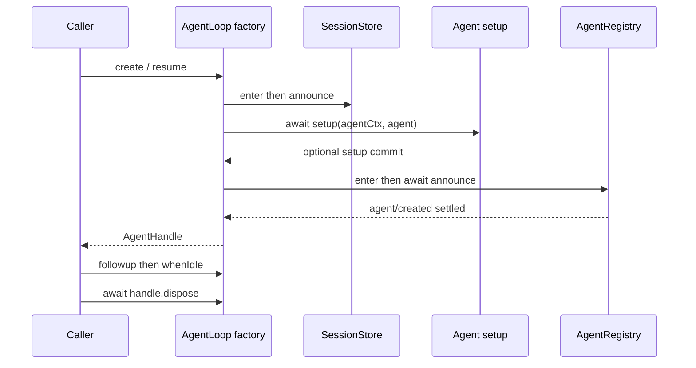

# 第二篇：沿一次插件调用读懂新版执行链

本篇固定源码 `22ddee3792402c3e70ec5f86a63c3e3e895a2f60`（`0.2.1-rc.3`），解释从创建 Agent 到工具返回、取消和卸载的交接对象。读者可以据此判断一个 hook 运行时，模型、工具、Session 与外部副作用分别处于什么阶段。文中的实现结论来自固定提交；工单等业务设计为建议。

## 1. 创建：Session 先公告，Agent 后发布

`AgentLoop` 创建 driver 后，先把尚未存储的历史后缀接入持久路径，再执行 `sessions.enter()`、`sessions.announce()`，随后运行 `setup(agent.ctx, agent)`。setup 成功后才把 Agent 放入 live registry，await `agents.announce()`，最终返回 handle。`agent/created` 的 serial listener 因而有机会在排队工作运行前完成初始化。[E21 · Session 公告、setup、Agent 发布及失败清理](https://github.com/deepseek-ai/deepseek-harness/blob/22ddee3792402c3e70ec5f86a63c3e3e895a2f60/packages/core/agent-loop/src/index.ts#L616-L651)



store-owned Session 在公告完成前和移除后拒绝追加；创建监听器内不能写 Session，setup 中则可以。独立 `Session.create()` / `fromRestore()` 的构造用途不受同一规则约束。创建失败还可能已经留下历史或 setup 事件，不能假定同一 id 可以从零重建。带持久数据的重试应考虑 resume。[E22 · store-owned Session 写入与创建顺序变化](https://github.com/deepseek-ai/deepseek-harness/blob/22ddee3792402c3e70ec5f86a63c3e3e895a2f60/docs/upgrade-guide/v0.2.1-rc.2/session-store-writes/guide.md#L1-L25)

这也解释了两个常见错误：在 setup 内装一个 `session/created` listener，会错过自己的公告；在 `session/created` 内通过 registry 找当前 Agent，也不具备有效顺序依据。业务初始化应选择 setup 或 `agent/created`。

## 2. 模型选择：`pending` 与 `lastUsed` 不是一次请求

选择的公开结构来自 `dsh-agent/types`：provider、model 和可选 reasoning effort。`AgentModel` 读取 driver 拥有的投影；`current()` 优先 `pending`，其次 `lastUsed`，都没有时回退 AgentOptions。`select()` 把选择写为 `model/selection`，不会直接向 provider 发送请求。[E08 · modelSelection fold、AgentModel 与切换提示](https://github.com/deepseek-ai/deepseek-harness/blob/22ddee3792402c3e70ec5f86a63c3e3e895a2f60/packages/core/agent/src/model-selection.ts#L17-L174) [E28 · 模型选择、恢复与 effort 的迁移说明](https://github.com/deepseek-ai/deepseek-harness/blob/22ddee3792402c3e70ec5f86a63c3e3e895a2f60/docs/upgrade-guide/v0.2.1-alpha.4/session-model-selection/guide.md#L1-L28)

|数据|生产者|消费与状态变化|
|---|---|---|
|`model/selection`|`agent.model.select()`|投影更新 `pending`|
|`request/header`|Loop 已准备的请求|投影更新 `lastUsed`；匹配的 pending 被消耗|
|`ModelSelectionProjectionState`|投影 fold|保存 lastUsed/pending；遗漏的 effort 不被冒充显式选择|
|`PreparedStep.selection`|`preStep()` 捕获|本 Step 与重试使用，不随之后的选择修改|

例如，第一 Step 调用工具时选择了下一模型，第二 Step 可使用新选择。若在 Step 1 的 `agent/pre-step` listener 内才 `select()`，此时捕获已经完成，第一请求仍使用旧模型；本批集成测试用 `['base', 'policy']` 验证了这条顺序。`select()` 不是实时变更已经准备的调用。

## 3. 准入：从注册表取得一次 Step 的能力集合

`preStep()` 先 claim 输入并捕获 selection，再 await `tools.resolve({ agent, modelSelection: selection, signal })`，把结果同时传给 prompt assembly。之后才派发 `agent/pre-step`。核心返回对象是 `{ ...decision, assembly, selection, toolSet }`；拒绝、异常和取消路径会 dispose toolSet，成功路径由 Turn 的 finally 收尾。[E05 · preStep 捕获模型并准入工具、组装和清理](https://github.com/deepseek-ai/deepseek-harness/blob/22ddee3792402c3e70ec5f86a63c3e3e895a2f60/packages/core/agent-loop/src/agent.ts#L276-L310) [E06 · Turn 消费 PreparedStep 与 finally 释放 toolSet](https://github.com/deepseek-ai/deepseek-harness/blob/22ddee3792402c3e70ec5f86a63c3e3e895a2f60/packages/core/agent-loop/src/agent.ts#L335-L390)

以下摘录来自该固定提交的 `preStep()`；它展示 `selection` 与 `toolSet` 如何共同进入 assembly：

```ts
const claimed = this.inbox.claim(target, position.turn)
const selection = this.model.current()
if (selection === undefined) {
  throw new Error(`agent "${this.id}" has no provider/model: set AgentOptions.provider and AgentOptions.model or record a model selection`)
}
const toolSet = await this.loopCtx.tools.resolve({ agent: this, modelSelection: selection, signal })
try {
  const assembly = await this.loopCtx.systemPrompt.assemble({ ...assembleContextFor(this, signal), modelSelection: selection, toolSet })
```

`ToolRegistrationOptions.when` 是每个 Step 的启用条件，可以异步；条件拿到同一个 Agent、捕获的 selection 和 signal。`ResolvedToolSet` 则暴露 `view(scope)` 与 `dispose()`，没有长期可变的“当前权限列表”。[E03 · 条件工具与 ResolvedToolSet 声明](https://github.com/deepseek-ai/deepseek-harness/blob/22ddee3792402c3e70ec5f86a63c3e3e895a2f60/packages/core/tools/src/contracts.ts#L104-L137)

`tools.resolve()` 先记住可见定义和 registration 身份。后续 `view()` 只有在 scope 相同、集合未关闭、定义及 registration 仍为原对象时才返回工具。因此，一个条件异步返回 true，不能复活等待期间已经被卸载的注册。相同工具名重新注册也不等价于旧 Step 获得新实现。[E04 · 工具查询、条件准入与 registration 身份复核](https://github.com/deepseek-ai/deepseek-harness/blob/22ddee3792402c3e70ec5f86a63c3e3e895a2f60/packages/core/tools/src/index.ts#L230-L300)

|分支|当前行为|插件实现的责任|
|---|---|---|
|when 返回 false|模型声明、Native/PTC 和嵌套执行均无该工具|不要另外在 prompt 文本宣称可调用|
|when 抛错|包装为 `ToolActivationError`，Turn 失败|提供可定位诊断；别静默改为允许|
|无 toolSet 的直接调用|条件工具不可执行|显式 resolve、传入集合、finally dispose|
|准入后注册被撤销或替换|未启动的旧调用不能取得实现|允许 UNKNOWN_TOOL；别偷偷切到新代|

`system-prompt/assemble` 的公开 presentation 已不含工具数组。继续修改 `assembly.tools` 不再是合法筛选方式；只过滤文本也无法形成执行授权。普通能力差异用 scoped registrations/restrict，Step 条件用 `when`，业务执行不变量用 guard。[E29 · 条件准入、组装接口与未知工具行为](https://github.com/deepseek-ai/deepseek-harness/blob/22ddee3792402c3e70ec5f86a63c3e3e895a2f60/docs/upgrade-guide/v0.2.1-rc.2/conditional-tools/guide.md#L1-L25)

## 4. 请求：先绑定 provider，再提交模型可见输入

`step()` 拿到 PreparedStep 后进入 attempt 循环。每次先 `prepareRequest(turn, step, decision.selection, signal)`，再刷新 runtime context，依据 prepared call 的能力处理 system prompt。首 attempt 才接纳本 Step 的用户消息；重试保留同一 selection 和 toolSet，不重新 claim 或解析条件。[E30 · 绑定调用后再提交系统提示和接纳输入](https://github.com/deepseek-ai/deepseek-harness/blob/22ddee3792402c3e70ec5f86a63c3e3e895a2f60/packages/core/agent-loop/src/agent.ts#L430-L475)

`prepareRequest()` 从已有 header 提取输出控制，剥离 provider/model/effort，再合并捕获的 selection。兼容用 `agent/request` waterfall 返回后，源码立即比较 route 和 effort；变更会 throw，发生在 `llm.prepareCall()` 和模型调用之前。允许 listener 调 `next()` 不意味着它仍有旧版的选模权限。[E07 · prepareRequest 拒绝 deprecated hook 变更路由或 effort](https://github.com/deepseek-ai/deepseek-harness/blob/22ddee3792402c3e70ec5f86a63c3e3e895a2f60/packages/core/agent-loop/src/agent.ts#L606-L651)

模型可见事实通过 Session 事件提交，随后构造冻结历史。取消发生在准备调用的异步阶段时，不提交此次新的 system/user 输入；这项行为有现有实现与上游测试支持，不能外推为“取消回滚此前所有 Session 记录”。本轮新测试额外确认旧 hook 路由被拒绝且 adapter 收到 0 个请求。[E30 · 绑定调用后再提交系统提示和接纳输入](https://github.com/deepseek-ai/deepseek-harness/blob/22ddee3792402c3e70ec5f86a63c3e3e895a2f60/packages/core/agent-loop/src/agent.ts#L430-L475) [E31 · 取消测试的真实 runtime 装配和结算意图](https://github.com/deepseek-ai/deepseek-harness/blob/22ddee3792402c3e70ec5f86a63c3e3e895a2f60/packages/core/agent-loop/tests/cancel.spec.ts#L1-L99)

## 5. 执行：Executor 接管 batch，pipeline 结算每个工具

`ToolsService.execute(input)` 按 Agent scope 选择 executor 并直接委派。Native provider 的 `describe()` 把准入定义投影为模型 schemas；`execute()` 调共享 `executeToolBatch()`，调度交给 `ToolExecutionPipeline`。PTC provider 通过同一能力定义提供程序绑定。自定义 executor 必须自己满足完整 batch 的顺序、取消、日志和排空义务，不能只实现一个 execute 回调。[E09 · NativeToolExecutor 描述与 batch 委派](https://github.com/deepseek-ai/deepseek-harness/blob/22ddee3792402c3e70ec5f86a63c3e3e895a2f60/packages/core/tool-executor-native/src/index.ts#L1-L35) [E10 · ToolBatchInput、Result 与 executor 排空义务](https://github.com/deepseek-ai/deepseek-harness/blob/22ddee3792402c3e70ec5f86a63c3e3e895a2f60/packages/core/tools/src/executor.ts#L20-L102) [E27 · 移除 tools.mode 及 executor 选择](https://github.com/deepseek-ai/deepseek-harness/blob/22ddee3792402c3e70ec5f86a63c3e3e895a2f60/packages/core/tools/src/index.ts#L99-L115)

关键输入字段如下，声明位置见 [E10 · ToolBatchInput、Result 与 executor 排空义务](https://github.com/deepseek-ai/deepseek-harness/blob/22ddee3792402c3e70ec5f86a63c3e3e895a2f60/packages/core/tools/src/executor.ts#L20-L102)：

|字段|含义与所有权|
|---|---|
|`calls`|模型返回的原始 ToolCallBlock 顺序|
|`signal`|调用者取消；必填|
|`agent`|可选所有者，决定 scoped 注册和执行上下文|
|`toolSet`|该 Step 的准入结果；条件工具执行必须使用|
|`log: {turn, step}`|仅已经提交的模型 Step 使用；普通服务调用省略|
|`maxParallelToolCalls`|本 batch 的可并发根调用限制，和 PTC 子调用限制分开|

pipeline 的 around-wrapper 进入工具 body 前，重新通过 `resolveExecution(..., toolSet)` 找可执行定义。它融合原始 caller signal 与 wrapper signal，await `tool.execute()`，将返回值变为 canonical result；finally 恢复 wrapper signal 并撤销融合监听。取消后仍等待已经启动的 body 停稳。[E32 · 融合信号、重新解析定义并等待 body](https://github.com/deepseek-ai/deepseek-harness/blob/22ddee3792402c3e70ec5f86a63c3e3e895a2f60/packages/core/tools/src/pipeline.ts#L254-L290)

`complete()` 再处理 post-execute、最终 content 和冻结结果，然后通知 `tools/result` observer。`output.render` 给模型的文字与 canonical value 是两个消费面；canonical value 是 PTC 的程序结果，不能把“模型显示已隐藏字段”当作程序无法读取字段。敏感策略需要阻止或替换 value，而非只改 content。[E33 · post-execute、最终冻结与 result 通知](https://github.com/deepseek-ai/deepseek-harness/blob/22ddee3792402c3e70ec5f86a63c3e3e895a2f60/packages/core/tools/src/pipeline.ts#L327-L394) [E20 · typed 输入、canonical 输出、取消、背景作业与策略](https://github.com/deepseek-ai/deepseek-harness/blob/22ddee3792402c3e70ec5f86a63c3e3e895a2f60/docs/cookbook/adding-a-tool.md#L9-L84)

本轮 `sum-tool` 返回 number，真实 Loop 将 `5` 作为 tool 结果加入第二次模型请求；参数 `a: 'bad'` 得到 `INVALID_ARGS`。这证明定义、输入校验、body、render、Session 回写与下一 Step 消费衔接成功，范围是受控 adapter 下的真实 runtime。

## 6. 取消、卸载与业务确认

取消是操作信号；`whenIdle()` 是 driver 已完成当前运行的等待点；`handle.dispose()` 拥有 Agent 的停止和资源释放。工具 body 如果忽略 signal，runtime 等待 quiescence 可能持续很久。用 `Promise.race()` 返回“超时成功”却留下仍在写数据库的请求，会破坏 executor 的结算义务。[E10 · ToolBatchInput、Result 与 executor 排空义务](https://github.com/deepseek-ai/deepseek-harness/blob/22ddee3792402c3e70ec5f86a63c3e3e895a2f60/packages/core/tools/src/executor.ts#L20-L102) [E32 · 融合信号、重新解析定义并等待 body](https://github.com/deepseek-ai/deepseek-harness/blob/22ddee3792402c3e70ec5f86a63c3e3e895a2f60/packages/core/tools/src/pipeline.ts#L254-L290)

卸载工具注册使后续未启动调用失效；它不会回滚已经发生的外部效果。卸载模型策略也不会删除已记录的 `model/selection`。本批测试分别验证“已准入后卸载得到 UNKNOWN_TOOL”和“策略卸载后现有 Agent 仍使用持久选择”。

企业写工具还需要 operation id、外部状态核对、事务确认与授权重查。这是扩展建议：业务 receipt 表示业务提交，`tool/result` 表示 runtime 记录了工具结算，两者关联但不能互相替代。进程崩溃夹在这两点之间时，自动重试必须有外部幂等依据。

## 7. 投影读模型也有独立寿命

当前用法是 `const handle = await ctx.sessionProjections.register(definition)`，随后调用 `handle.stateOf(session)`。`handle.dispose()` 撤销全局参与；保留的 handle 仍引用原 unit 并能按需 fold 后续事件，不会自动指向后来同 key 的新版本。`register()` 的兼容返回值是 callable thenable；新异步插件应 await 并返回 void，避免把 handle 当作 Cordis effect 返回。[E12 · callable thenable、await acquire、handle 与释放](https://github.com/deepseek-ai/deepseek-harness/blob/22ddee3792402c3e70ec5f86a63c3e3e895a2f60/packages/session/session-projection/src/index.ts#L302-L430)

这条链提供一个具体的架构方法：把“注册存在”“某次 Step 已获准”“业务操作已提交”“读模型已更新”“资源已释放”分别定义。跨版本适配时沿交接数据检查，而不只搜索同名函数是否仍在。当前异常和取消用例、原生构建及限制见[验证附录](appendices/validation.md)。
